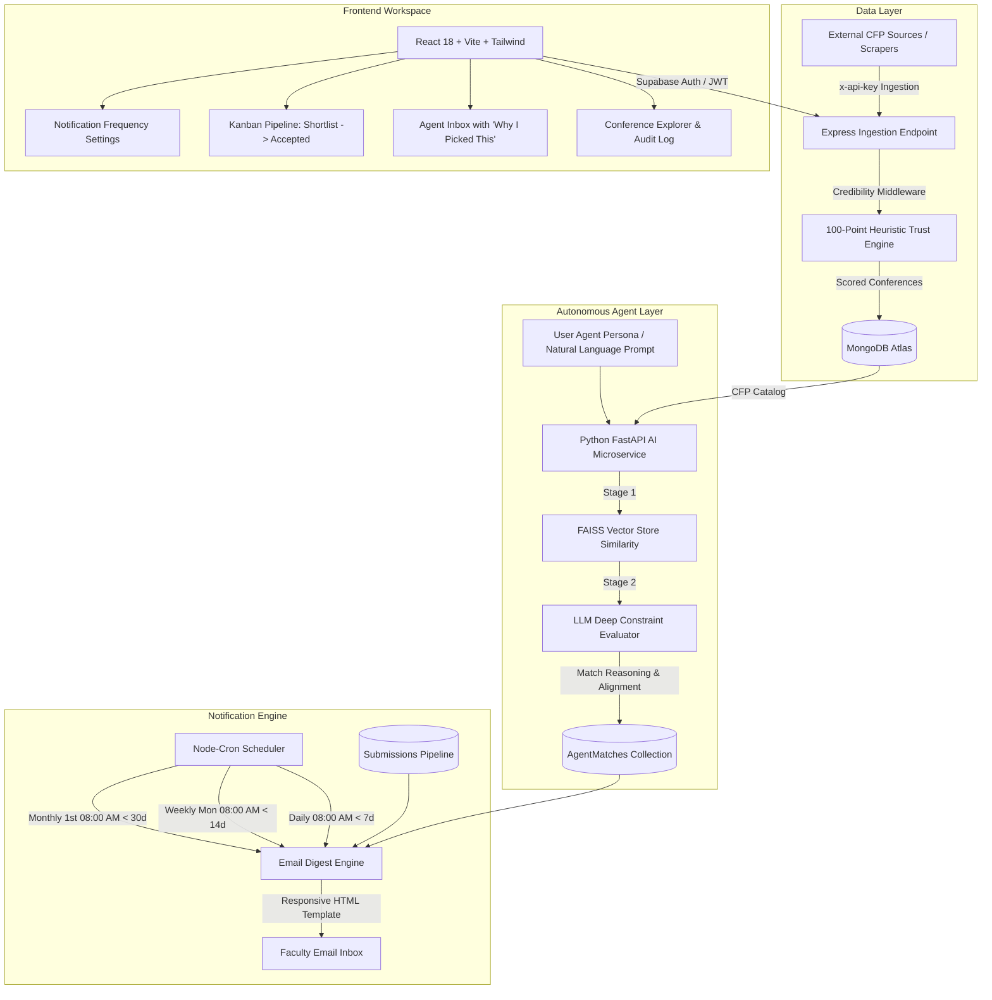

# Researchly.io — Autonomous AI Conference Intelligence & Credibility Platform

Researchly.io is a production-ready, full-stack intelligence platform built for academic faculty and researchers. It features automated conference discovery, a heuristic Credibility Engine (Trust Score 0-100), autonomous background AI agents with FAISS semantic matching, a Kanban submission tracker, and scheduled email digest notifications via `node-cron` and Nodemailer.

---

## 🏗️ System Architecture & Data Flow



---

## 🚀 Core Technology Stack

- **Frontend:** React 18, Vite, Tailwind CSS, Lucide Icons, React Router DOM v6.
- **Backend:** Node.js, Express.js, Mongoose, `@supabase/supabase-js`, Nodemailer, `node-cron`.
- **Database:** MongoDB Atlas (with automatic zero-config memory server fallback for instant development).
- **Authentication:** Supabase Auth (Email/Password) with 1-Click Faculty Demo Login.
- **AI Microservice:** Python 3, FastAPI, FAISS, Sentence Transformers / Vector Similarity, Autonomous Agentic Researcher.
- **Notification Engine:** Nodemailer with responsive HTML email templates and `node-cron` background schedulers.

---

## 📁 Repository Structure

```
Researchly/
├── package.json                    # Root workspace runner scripts
├── backend/
│   ├── package.json
│   ├── server.js                   # Express API entry point
│   ├── config/
│   │   ├── db.js                   # MongoDB Atlas connection + in-memory fallback
│   │   └── supabase.js             # Supabase admin client
│   ├── models/
│   │   ├── User.js                 # Faculty user profile & preferences
│   │   ├── Conference.js           # Audited CFP conference model
│   │   ├── AgentMatch.js           # LLM agent match reasoning
│   │   └── Submission.js           # Kanban pipeline paper tracking
│   ├── middleware/
│   │   ├── auth.js                 # Supabase JWT & scraper API key auth
│   │   └── credibilityEngine.js    # Automatic Trust Score middleware
│   ├── routes/
│   │   ├── authRoutes.js           # User sync & preferences
│   │   ├── conferenceRoutes.js     # Catalog search, filter & ingestion
│   │   ├── agentRoutes.js          # Agent persona, scan trigger & matches
│   │   ├── submissionRoutes.js     # Kanban pipeline CRUD
│   │   └── notificationRoutes.js   # Frequency settings & test digest
│   ├── services/
│   │   ├── credibilityService.js   # 100-point heuristic scoring rules
│   │   ├── emailService.js         # Nodemailer & modern HTML email template
│   │   └── schedulerService.js     # Node-cron daily/weekly/monthly jobs
│   └── seed/
│       └── seedData.js             # Preloaded IEEE, ACM, Springer & predatory tests
├── ai-service/
│   ├── requirements.txt
│   ├── main.py                     # FastAPI microservice
│   ├── vector_store.py             # FAISS vector store & embeddings
│   └── agent.py                    # Autonomous Research Assistant agent
└── frontend/
    ├── package.json
    ├── vite.config.js
    ├── tailwind.config.js
    ├── index.html
    └── src/
        ├── App.jsx                 # Routes & protected layouts
        ├── index.css               # Modern glassmorphism & typography
        ├── context/
        │   └── AuthContext.jsx     # Supabase Auth provider + Demo login
        ├── components/
        │   ├── Navbar.jsx          # Top navigation & user profile
        │   ├── ConferenceCard.jsx  # Conference card with deadline countdowns
        │   ├── TrustScoreBadge.jsx # Dynamic trust badge (Tier-1, Caution)
        │   ├── EvidenceModal.jsx   # Detailed Credibility Engine audit log
        │   ├── AgentConfigModal.jsx# Natural language prompt editor
        │   ├── NotificationModal.jsx# Email frequency & test email trigger
        │   └── AddToPipelineModal.jsx# 1-Click addition to Kanban board
        └── pages/
            ├── LandingPage.jsx     # Hero page with live Trust Score demo
            ├── LoginPage.jsx       # Supabase email/password & 1-click login
            ├── RegisterPage.jsx    # Academic signup form
            ├── Dashboard.jsx       # Faculty intelligence overview & metrics
            ├── ConferenceExplorer.jsx # Filterable conference discovery
            ├── AgentInbox.jsx      # Agent recommendations & LLM explanations
            ├── KanbanPipeline.jsx  # Drag-and-drop submission stages
            └── Settings.jsx        # Notification & agent persona settings
```

---

## ⚡ Quick Start Guide

### 1. Backend Setup
```bash
cd backend
npm install
npm start
# Server starts at http://localhost:5000
```
*Note: If no `MONGODB_URI` is provided in `.env`, the backend will automatically spin up an in-memory MongoDB Atlas simulator and seed it with realistic conferences!*

### 2. Frontend Setup
```bash
cd frontend
npm install
npm run dev
# Frontend runs at http://localhost:5173
```

### 3. AI Microservice Setup (Optional for standalone Python FAISS service)
```bash
cd ai-service
pip install -r requirements.txt
python main.py
# FastAPI runs at http://localhost:8000
```
*Note: If the Python microservice is not running, the Express backend automatically runs a built-in semantic & constraint agent fallback, ensuring zero downtime!*

---

## 🧪 Testing the 5 Phases

### Phase 1: Supabase Authentication
1. Navigate to `http://localhost:5173/login`.
2. Click **"1-Click Faculty Demo Login"** to instantly log in as Dr. Elena Rostova (Stanford AI Lab), or sign in with Supabase Email/Password.
3. Observe session synchronization with the backend MongoDB database.

### Phase 2: Credibility Engine
1. Go to **Conference Explorer** (`/dashboard/explorer`).
2. Notice the **Trust Scores**:
   - IEEE ICASSP: `96/100` (Accredited publisher, Scopus indexed).
   - WASET ICCS: `18/100` (Flagged predatory network, generic email contact, unrealistic review speed).
3. Click any **Trust Badge** to view the **Credibility Engine Audit Trail** showing all passed/failed heuristic checks.

### Phase 3 & 4: Autonomous Agent & Inbox
1. Click **"Agent Persona"** in the top navigation.
2. Enter your constraints (e.g., *"Find credible IEEE or ACM conferences in Europe with low fees"*).
3. Click **"Run Autonomous Scan Now"**.
4. Navigate to **Agent Inbox** (`/dashboard/inbox`) to inspect the top recommendations with detailed LLM rationale: **"Why I picked this for you"**.
5. Click **"Add to Submission Kanban"** on any match.
6. Open **Submission Kanban** (`/dashboard/kanban`) to track your paper across `Shortlisted` ➔ `Preparing` ➔ `Submitted` ➔ `Accepted`.

### Phase 5: Email Notification Engine
1. Go to **Settings** (`/dashboard/settings`) or click the Bell icon.
2. Select your frequency: **Daily Digest** (< 7 day deadlines), **Weekly Digest** (< 14 day deadlines), or **Monthly Brief** (< 30 day deadlines).
3. Click **"Send Test Digest Now"**.
4. The backend will compile your unread Agent matches and approaching milestones into a responsive HTML email and return an **Ethereal Preview URL** to inspect the rendered email in your browser!
